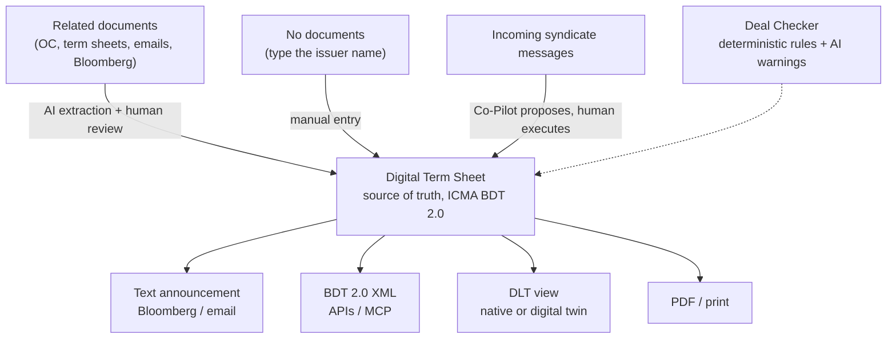

# Digital Deal Room: open-source Digital Term Sheet

[](https://github.com/MowCop/open-source-digital-bond-term-sheet/actions/workflows/ci.yml)
[](LICENSE)
[](https://www.icmagroup.org/fintech-and-digitalisation/)

**Live demo: [eurobondmarkets.com](https://eurobondmarkets.com)** (access is granted on approval)

Digital Deal Room (DDR) is a workspace for the people who execute new bond issues: syndicate and DCM desks, issuers, and their legal counsel. It keeps one **Digital Term Sheet (DTS)** for each deal, updates it in real time during syndication, and publishes it in whatever form each audience needs: a text announcement for Bloomberg or email, **ICMA Bond Data Taxonomy (BDT) 2.0 XML** for systems, or a **DLT / tokenised** view.

> **Status:** working prototype, built with [Lovable](https://lovable.dev) and deployed at eurobondmarkets.com. Demo deals and sample documents are illustrative. Nothing in this repository is an offer of securities or investment advice.

---

## Why a Digital Term Sheet?

During a bond issue the terms change throughout the day, moving from initial price thoughts to guidance, launch, pricing and final terms. Today that history is spread across Bloomberg messages, emails, PDFs and spreadsheets, and every participant re-keys it. The DTS gives the deal **one source of truth**, structured from the start to the ICMA standard, so that the announcement text, the machine-readable data and the final terms all come from the same record.

## Use cases

| Use case | What the DDR does |
|---|---|
| **Start a deal from documents** | Drop in an offering circular, preliminary term sheet, email or forwarded Bloomberg message. AI extraction proposes values for each BDT field, and a person reviews them before anything is saved. |
| **Start a deal from nothing** | Type an issuer name to create a draft DTS and fill it in manually. GLEIF suggests the issuer's LEI and OpenFIGI suggests identifiers. |
| **Run syndication** | Move the DTS through its stages (announcement → IPTs → guidance → launch → priced → final). Each stage is saved as an immutable release, so you can see exactly what was published and when. |
| **Send deal updates** | Write one whole-deal "Terms" message from the live DTS and send it to distribution lists, including Bloomberg recipients, with a warning if the terms have changed since the draft was written. |
| **Ingest incoming updates** | Paste or forward a syndicate message. The Deal Co-Pilot proposes the field changes, and a person presses *Execute* to apply them. |
| **Check the deal** | The Deal Checker applies deterministic ICMA and market-convention rules (dates, day counts, settlement, identifiers, holiday calendars). AI review is an extra layer and gives warnings only. |
| **Multi-tranche deals** | One deal can hold several live tranche term sheets, each with its own status and BDT output. |
| **Machine-readable output** | Export BDT 2.0 XML that validates against the ICMA XSD, or a DLT view (native digital bond or digital twin) with a token envelope. |
| **Share with guests** | Give external parties time-limited, passcode-based access to specific deals. |

## How it works



**Design principles**

- **ICMA BDT 2.0 is the schema.** Each term-sheet field is defined once, in `src/lib/termsheet/fields.js`, and `src/lib/bdt-bridge.ts` is the only path between that dictionary and app state.
- **People approve, AI proposes.** AI never writes to a term sheet without a person approving the change.
- **Deterministic checks stay deterministic.** Validation rules are plain code with tests. They never depend on a model.
- **Everything is audited.** Logins, approvals, sends and term changes are written to an audit log.

## Architecture

| Layer | Technology |
|---|---|
| Front end | React 18, TypeScript, Vite, Tailwind CSS, shadcn/ui |
| Term sheet core | Framework-free ES modules in `src/lib/termsheet/` (field dictionary, BDT XML, DLT, validation, ingest) |
| Backend | Lovable Cloud (Supabase): Postgres with row-level security, Auth, Storage, Edge Functions (Deno) |
| AI | Edge functions for extraction, Deal Co-Pilot and deal audit. Model choice is configurable. |
| Data services | GLEIF (LEI), OpenFIGI (FIGI), public market feeds |
| Tests | Vitest unit tests; `verify.mjs` / `verify-dlt.mjs` regression against reference outputs; `xmllint` validation against the ICMA XSD |

```
src/lib/termsheet/      Term sheet core: fields, BDT XML, DLT view, validation, ingest
src/lib/bdt-bridge.ts   Bridge between the field dictionary and app state
src/lib/copilot/        Deal Co-Pilot command parsing and previews
src/components/, pages/ React UI
supabase/functions/     Edge functions (AI extraction, Co-Pilot, alerts, guest access, lookups)
drizzle/                Database schema and migrations
schema/                 ICMA Bond Data Taxonomy 2.0 XSDs and a sample instance
reference/              Reference outputs, standards notes and the demo deal walkthrough
```

## Getting started

Prerequisites: Node 20+ and [Bun](https://bun.sh). Bun is used because `bun.lock` is the lockfile Lovable maintains.

```sh
git clone https://github.com/MowCop/open-source-digital-bond-term-sheet.git
cd open-source-digital-bond-term-sheet
bun install
bun run dev          # http://localhost:8080
```

The app connects to the Supabase project set in `.env`. The values there are the **publishable** URL and anon key. They are meant to be in the browser bundle, and data access is enforced by row-level security on the server. To run against your own backend, copy `.env.example`, point it at your own Supabase project and apply the migrations in `drizzle/`.

### Checks

```sh
bun run typecheck    # TypeScript
bun run test         # Vitest unit tests
bun run verify       # term sheet core + DLT view match the reference outputs
xmllint --noout --schema schema/icma-bond-data-taxonomy.xsd module-output.xml
```

CI runs all of these on every push and pull request.

## Standards and references

- [ICMA Bond Data Taxonomy](https://www.icmagroup.org/fintech-and-digitalisation/) (BDT 2.0). The XSDs in `schema/` are ICMA's published schema files.
- ICMA Primary Market Handbook: Appendix A8 (final terms pro forma) and Appendix C1 (BDT)
- ICMA FAQ on DLT and blockchain in bond markets

## Contributing

Contributions are welcome from banks, syndicate/DCM and legal professionals, and developers. See [CONTRIBUTING.md](CONTRIBUTING.md). To report a vulnerability, see [SECURITY.md](SECURITY.md).

## Headless Taxonomy Engine (SDK / microservice)

The ICMA BDT 2.0 engine behind the DDR is available on request as an SDK or a standalone microservice. It is not part of this repository. Contact the team via [eurobondmarkets.com](https://eurobondmarkets.com).

## Licence

Apache License 2.0. See [LICENSE](LICENSE). Third-party standards documents and schemas remain the property of their publishers.
